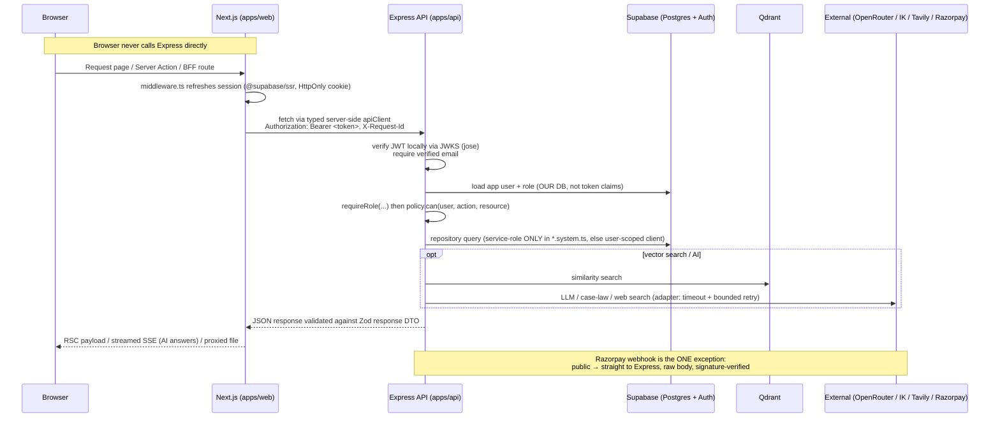
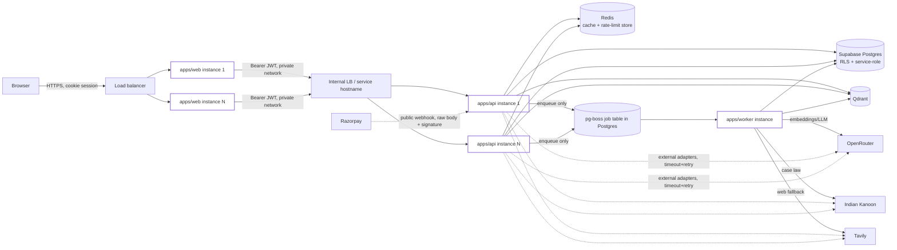
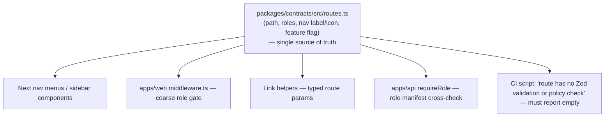

# Target Architecture — Vidhira Migration

Derived from `docs/MASTER-PROMPT.md`. This is the architecture we are migrating *to*; current state is documented in `00-inventory.md`. No code has been written yet — this is the plan the phased migration will implement.

---

## 1. Why this shape

Current blockers (from `00-inventory.md`): hash-tab SPA routing with no real URLs, in-memory identity cache / rate-limit store (breaks horizontal scaling), Express serving both API and static SPA from one process, no TypeScript, no shared request/response contracts, zero RLS policies (app-code-only authorization), long-running RAG jobs sharing the API process.

The target fixes each of these without changing product behaviour:
- Real URLs via Next.js App Router replace hash tabs.
- Express stays as the system of record but moves behind Next (BFF pattern) and becomes stateless (Redis-backed cache/rate-limit, JWKS-verified JWTs instead of a Supabase round-trip + in-process Map).
- A dedicated `apps/worker` takes over RAG ingest/reindex and anything long-running, so the API process stays fast and horizontally interchangeable.
- `packages/contracts` (Zod) becomes the single source of truth for request/response shapes and the route/role manifest, consumed by both `apps/web` and `apps/api`.

---

## 2. Request flow



Key rule: Express is zero-trust. It never assumes "the call came from Next so it's safe" — every request is re-verified (JWT, role, object-level policy) regardless of caller.

---

## 3. Module layering (per domain, inside `apps/api`)

```mermaid
flowchart TD
    subgraph apps_api["apps/api/src/modules/<domain>/"]
        R["router.ts<br/>(HTTP verbs/paths only)"]
        V["schemas.ts<br/>(re-exports packages/contracts Zod schemas)"]
        P["policy.ts<br/>(authz: ownership, account membership,<br/>matter_access_grants, role rules)"]
        SV["service.ts<br/>(domain/business logic)"]
        RP["repository.ts<br/>(DB access, DTO mapping)"]
    end

    subgraph integrations["apps/api/src/integrations/"]
        I1[supabase]
        I2[qdrant]
        I3[openrouter]
        I4[indiankanoon]
        I5[tavily]
        I6[razorpay]
        I7[storage]
    end

    HTTP[Incoming HTTP request] --> R
    R -->|validate params/query/body| V
    R --> SV
    SV -->|policy.can(user, action, resource)| P
    SV --> RP
    SV -.->|external calls only via adapter| integrations
    RP --> DB[(Postgres via Supabase)]
    SV -->|map to response DTO, validate| V
    V --> R
    R --> HTTPOUT[HTTP response]

    classDef zero fill:none,stroke-dasharray: 5 5
    class integrations zero
```

Rule: **zero business logic in routers.** Router → Zod validation → Service → Policy check → Repository/Integration. This mirrors the existing `services/access.js` pattern (`assertAccountMember`, `loadMatterForUser`, `requireSide`) — Phase 2 ports that file into `policy.ts` per domain rather than rewriting the authorization logic from scratch.

---

## 4. Deployment topology



Properties this diagram must satisfy (acceptance criterion #6):
- `W1`/`W2` and `A1`/`A2` are identical, interchangeable instances — nothing correctness-critical in their process memory.
- Only the Razorpay webhook reaches Express directly from the public internet; everything else is browser → web → api.
- `apps/worker` is the only thing that runs long jobs (RAG ingest/reindex/reprocess/reembed); API only enqueues and polls status.

---

## 5. Route-manifest-driven navigation



This directly replaces `frontend/src/shell/navConfig.js` (`CLIENT_NAV`, `LAWYER_NAV`, `ADMIN_NAV`, `FOUNDER_NAV`, `FOUNDER_TABS`, `TAB_ALIASES`) — every entry in today's nav config maps to exactly one manifest entry in the target state (mapping to be produced at the start of Phase 3, per-slice, not invented wholesale up front).

---

## 6. What does NOT change

- Express stays Express (no Fastify/Nest rewrite).
- No ORM, no second database, no Tailwind/UI kit.
- All existing copy, validation rules, error messages, and "honest fallback" behaviours (e.g. `NoAdvocatesFallback`, optional-integration-not-enabled messaging, the research "not_found_reason" UX from migration 008) are preserved verbatim.
- `services/access.js`'s authorization primitives (`assertAccountMember`, `loadMatterForUser`, `requireSide`, the deliberate 404-not-403 on matter probing) are ported, not redesigned.

---

## 7. Open items carried from the inventory into later phases

These are not blockers for Phase 1, but are flagged so they aren't silently lost:
- `admin_access_grants` (unused table) — needs a product decision (finish vs. remove) before Phase 5 cleanup; see `00-inventory.md` §3/§9 and the delete list.
- Missing per-route rate limits on `research.js` (15 routes), `payments.js` intents/verify, and `askLearn.js`'s `/answers/:id/helpful` — to be closed when those domains are ported in Phase 3, using the new `platform/rateLimit` Redis-backed interface rather than patched onto the old in-memory one.
- Stale comment in `legalAssistant.js:29` claiming the route is unauthenticated — correct during that module's Phase 3 port.
- The in-process identity cache's cross-instance invalidation gap is resolved structurally by Phase 2 (JWKS local verification removes the cache's reason for existing).
